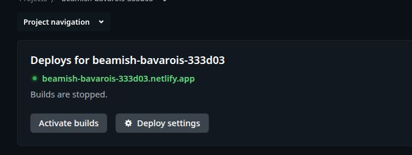

# PR #270 authentication repair evidence — 2026-10-26

Scope: the two reproduced P2 defects in [PR #270](https://github.com/HenriqueMichelini/careeros/pull/270), under the selected #262 sign-in slice. Reviewed head: `2d5a3f3e27281833a2b92032d5d27de1a83db8ab`; baseline: `2382f088f4c5c1433072cf0cf4c5cbdff0311c85`. These repairs do not approve provider configuration, shared storage, frontend integration, deployment or launch. P3 terminology and optional CSRF cleanup are deferred.

## Preserved review and regression evidence

The independent review and retained probes were read in place and left untouched. [Review provenance](pr270-auth-repairs/review-provenance.json) records their absolute local paths and SHA-256 digests.

Before modifying implementation, the HTTP regressions failed for both `callback_after_logout` and `provider_response_after_logout`: ordinary logout returned 204 and rejected the old token, yet the retained earlier callback returned 303 and issued a new session. Tests retain the callback binding cookie, so a cookie-only fix cannot satisfy them. The configured 5-minute JWKS fallback also failed to refetch at expiry. See [the red log](pr270-auth-repairs/regressions-red.log) and [execution metadata](pr270-auth-repairs/regressions-red.json).

The [green log](pr270-auth-repairs/regressions-green.log) includes both original schedules and a deterministic pause immediately before the session store commit, for both the same account and a different provider subject. Logout completes before insertion is released, which must then return `ErrInvalidTransaction`. The HTTP tests also require no replacement session, continued access from another device, unchanged account identity/generation, and successful fresh sign-in afterward.

## Repairs and atomicity boundary

- `SessionStore.Create` now accepts the initiating session ID and current issuance time. Under the same mutex as revocation, the memory store validates that a nonempty initiating session still exists and is unexpired, removes it and inserts the replacement. Failure inserts nothing; duplicate insertion does not revoke the initiator. Concurrent callbacks can consume an initiating session only once. An empty initiating ID permits a fresh sign-in. The service no longer separately revokes and then creates. Issuance time is refreshed after the provider exchange.
- `NewGoogleProvider` now explicitly accepts the fallback TTL, receives `Config.JWKSCacheTTL` from the production server and forwards it into `TokenVerifierConfig.CacheTTL`. Offline tests load production environment configuration and construct that provider with a fake transport, using signed synthetic ID tokens. They check one fetch before expiry and a second at expiry, with no live endpoint access. A valid positive provider `Cache-Control: max-age` takes precedence; fallback and header lifetimes both retain the 5-minute–24-hour clamp. Missing/invalid headers use the configured fallback; omitted configuration defaults to 1 hour.
- The `Revalidate` API comment now states its actual limit: separate reads do not make a subsequent authoritative resource commit atomic with revocation. Existing tests cover revocation before revalidation. Future persistence must compose trusted owner lookup, current session/account validation and resource writes atomically. These session-issuance regressions do not establish resource-commit safety.

The atomic store operation orders replacement issuance against revocation of its initiating session. If revocation wins first, insertion fails; if insertion wins first, it precedes revocation. This is a process-memory reference contract, not evidence of a durable multi-process implementation.

## Checks on the repaired source

All checks used `GOCACHE=/tmp/careeros-go-cache`, `GOPROXY=off` and `GOSUMDB=off`. Local mock HTTP servers and test subprocesses ran on the authorized host. No live Google, AI or other provider calls were made.

| Check | Result |
| --- | --- |
| Targeted new regressions | Pass after failing on the reviewed implementation; linked red/green logs |
| `go test -count=1 ./internal/auth ./internal/netlifyproxy ./cmd/profile-review` | Pass; [log](pr270-auth-repairs/targeted.log) |
| `go test -race -count=1 ./internal/auth` | Pass; [log](pr270-auth-repairs/auth-race.log) |
| `go test -race -count=100 ./internal/auth -run 'TestOrdinaryLogout\|TestConcurrentSessionReplacements\|TestConcurrentCallback\|TestLogoutRacing'` | Pass; [log](pr270-auth-repairs/auth-race-stress.log) |
| `go vet ./internal/auth ./internal/netlifyproxy ./cmd/profile-review` | Pass |
| `npm test` | 306/306 pass |
| `node_modules/.bin/tsc --noEmit` | Pass |
| `npm run build -- --outDir /tmp/pr270-auth-repairs/production-build` | Pass; [log](pr270-auth-repairs/npm-build.log); existing Vite config-loader/bundle-size warnings |
| `git diff --check` and Go formatting | Pass |
| `go test -json -count=1 ./...` | Evaluation Lab fails; 16 other tested packages pass; [failure summary](pr270-auth-repairs/go-all-summary.json) |

Execution metadata is retained alongside the linked logs. Full raw logs, including the full Go JSON stream and frontend test output, are retained locally under `/tmp/pr270-auth-repairs/`. The production build output is outside the repository.

## Additive ProcessRunner correction

The earlier PR/issue count of **13 top-level failures / 22 subtest failures** and description of **24 unrelated stale files** remain historical statements, superseded by this correction. The independent reviewer reproduced **13 top-level failures and 11 distinct named failing subtests**, with `source_changed` / approved-source-snapshot failures before expected execution. The repaired full Go suite independently reproduced those same counts and identities. Matching failures do not make all head drift inherited.

The [read-only manifest audit](pr270-auth-repairs/manifest-audit.json) used exact Git objects for baseline/reviewed head and current bytes for the repair:

| Condition | Baseline | Reviewed head | Repair |
| --- | ---: | ---: | ---: |
| Existing paths with mismatched hashes | 24 | 27 | 27 |
| Missing listed paths | 1 | 1 | 1 |
| Total stale entries | **25** | **28** | **28** |

The missing path is `tests/ingestion-browser.check.mjs`. The three newly stale patch-owned entries are `internal/netlifyproxy/handler.go`, `internal/netlifyproxy/handler_test.go` and `vite.config.ts`.

The 209-source manifest `docs/evaluations/test-adapters/cases.v3.json` retains SHA-256 `c3fb7be93b892adca689c9798370d89bac305454ae3268055488f25376e7c595` at all three snapshots. It was neither edited nor re-approved.

## Publication gate

Local source repairs and checks completed before publication. At `2026-10-26T19:28:33.322Z` (2026-10-26, 16:28:33 America/Sao_Paulo), the authenticated [Netlify project Deploys page](https://app.netlify.com/projects/beamish-bavarois-333d03/deploys) showed **Builds are stopped**, an **Activate builds** control, and the explanation that activating builds would resume continuous deployment and re-enable manual triggers. This current platform readback, rather than repository configuration or historical canceled builds, establishes the pre-push gate.

Retained [platform metadata](pr270-auth-repairs/platform-before-push.json) and [screenshot](pr270-auth-repairs/netlify-builds-stopped-before-push.jpg) were captured before the repair push. No Netlify setting was changed and no build/deploy was triggered. The platform's separate credit-related pause was not used as the prevention guarantee.

